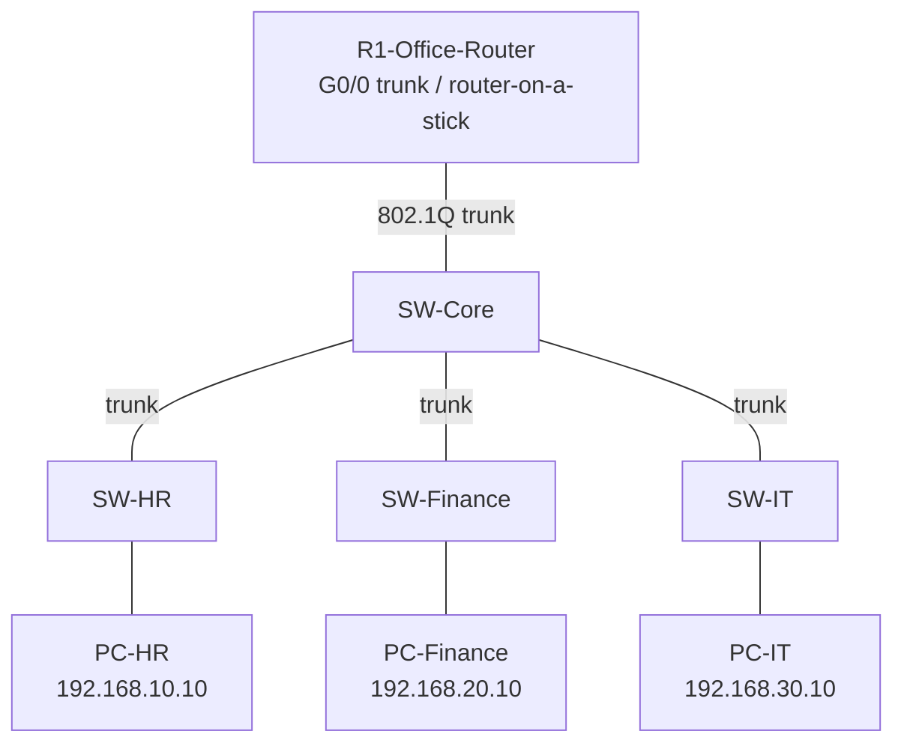

# Multi-Department Enterprise Network Design and Implementation

A Cisco Packet Tracer practice project that models a small enterprise network with separate HR, Finance, and IT VLANs. The design uses router-on-a-stick inter-VLAN routing, access ports for end devices, and 802.1Q trunk links between the core switch, department switches, and router.

> **Project status:** Core VLANs, trunks, router subinterfaces, and gateway reachability were configured. Screenshots also show successful and failed inter-VLAN ping tests and ACLs on the router. The failed pings indicate the project should not be described as fully working until the ACL policy and end-to-end connectivity have been checked.

## Objectives

- Segment departments using VLANs.
- Assign each department a separate IPv4 subnet.
- Configure access ports and 802.1Q trunk links.
- Enable inter-VLAN routing with router subinterfaces.
- Test connectivity and document troubleshooting evidence.
- Explore ACL-based traffic control between departments.

## Topology



## IP addressing and VLAN plan

| Department | VLAN | Network | Default gateway | Example PC |
|---|---:|---|---|---|
| HR | 10 | `192.168.10.0/24` | `192.168.10.1` | `192.168.10.10` |
| Finance | 20 | `192.168.20.0/24` | `192.168.20.1` | `192.168.20.10` |
| IT | 30 | `192.168.30.0/24` | `192.168.30.1` | `192.168.30.10` |

Subnet mask for all three networks: `255.255.255.0`.

## Physical/logical port map

| Device/port | Connected to | Purpose |
|---|---|---|
| SW-Core Fa0/1 | R1 G0/0 | 802.1Q trunk |
| SW-Core Fa0/2 | SW-HR Fa0/1 | Department trunk |
| SW-Core Fa0/3 | SW-Finance Fa0/1 | Department trunk |
| SW-Core Fa0/4 | SW-IT Fa0/1 | Department trunk |
| Department switch Fa0/1 | SW-Core | Trunk uplink |
| Department switch Fa0/2 | Department PC | Access port in department VLAN |

## Configuration summary

### Switches

- VLAN 10 named `HR`
- VLAN 20 named `FINANCE`
- VLAN 30 named `IT`
- PC-facing Fa0/2 ports assigned to their department VLANs
- Uplinks configured as trunks
- SW-Core Fa0/1–Fa0/4 configured as trunks

### Router-on-a-stick

Router physical interface `GigabitEthernet0/0` is enabled. Three subinterfaces provide the VLAN gateways:

| Subinterface | Encapsulation | IP address |
|---|---|---|
| `G0/0.10` | `dot1Q 10` | `192.168.10.1/24` |
| `G0/0.20` | `dot1Q 20` | `192.168.20.1/24` |
| `G0/0.30` | `dot1Q 30` | `192.168.30.1/24` |

See [`configs/router-on-a-stick-example.txt`](configs/router-on-a-stick-example.txt) for a reference configuration. Treat it as documentation, not a replacement for checking the current Packet Tracer configuration.

## Validation and evidence

Screenshots are in [`screenshots/`](screenshots/). The supplied evidence shows:

- Router subinterfaces and physical interface are `up/up`.
- The IT switch has VLAN 10, 20, and 30 active on its trunk uplink.
- PC-IT successfully pinged its own gateway (`192.168.30.1`) and PC-Finance (`192.168.20.10`).
- PC-HR successfully pinged PC-IT (`192.168.30.10`).
- PC-HR to PC-Finance and PC-Finance to PC-HR ping attempts failed with `Destination host unreachable`.
- Router output shows inbound ACLs `110` on `G0/0.10` and `120` on `G0/0.20`; these may explain why some cross-department traffic is blocked. Confirm intended policy before changing them.

### Suggested troubleshooting sequence

1. On each PC, verify IP address, mask, and default gateway.
2. Verify each PC-facing switch port is in the correct VLAN (`show vlan brief`).
3. Verify trunks and allowed VLANs (`show interfaces trunk`).
4. Verify router subinterfaces (`show ip interface brief`).
5. Inspect ACL definitions and interface direction (`show access-lists`, `show running-config`).
6. Retest each department-to-department flow against the intended security policy.

Do not remove ACLs blindly: first decide which departments should be allowed to communicate.

## Useful verification commands

```text
show vlan brief
show interfaces trunk
show ip interface brief
show running-config
show access-lists
```

From a PC command prompt:

```text
ping 192.168.10.1
ping 192.168.20.10
ping 192.168.30.10
```

## Repository contents

- `screenshots/` — selected Packet Tracer evidence supplied for the project
- `configs/` — reference router-on-a-stick configuration
- `docs/` — additional project notes

## Next steps

- Save the working topology as `Multi_Department_Enterprise_Network.pkt` and add it to the repository if you want to share the editable Packet Tracer project.
- Decide and document the desired inter-department ACL policy.
- Re-run the connectivity tests and update the results table after the ACL policy is confirmed.

## Tools

- Cisco Packet Tracer
- Cisco IOS-style switch/router CLI
- VLANs, IEEE 802.1Q trunking, IPv4 addressing, router-on-a-stick, and ACLs
